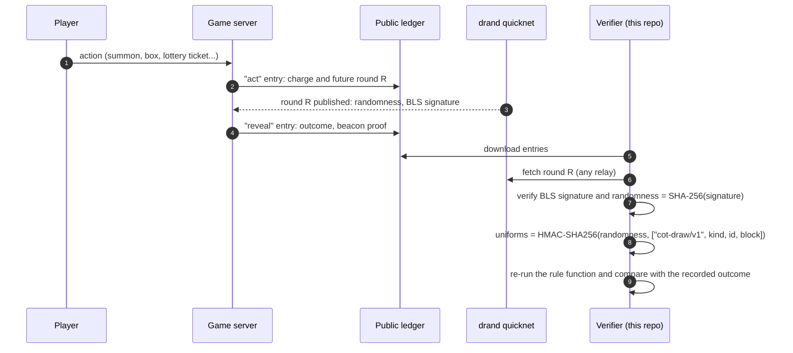
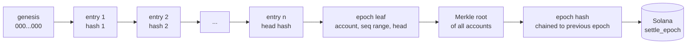
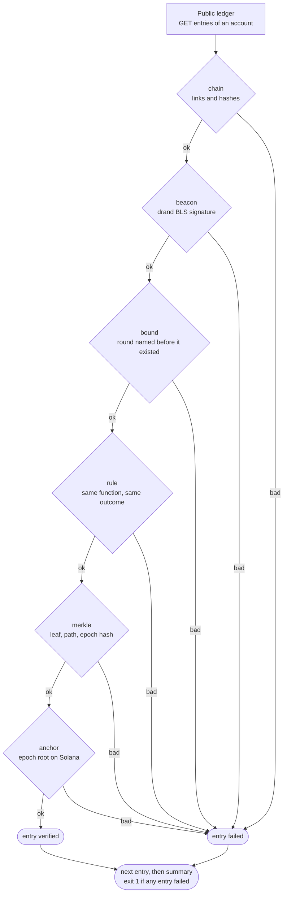

<p align="center">
  
</p>

<h1 align="center">Crypto of Thrones · core</h1>

<p align="center">
  <strong>Verifiable draws · Hash-chained ledger · Deterministic game rules</strong>
</p>

<p align="center">
  <a href="https://github.com/Crypto-of-Thrones/core/actions/workflows/guard.yml"></a>
</p>

This repository holds the code that decides what a player of [Crypto of Thrones](https://cot.gg)
earns and spends: every random draw, every recorded action and every on-chain payment rule. It is
published so that anyone, player or auditor, can recompute the game's results on their own machine
and check them against the public record, without trusting the game servers.

## Contents

- [What this repository is](#what-this-repository-is)
- [What it is not](#what-it-is-not)
- [Quickstart](#quickstart)
- [How a draw is verifiable](#how-a-draw-is-verifiable)
- [The hash-chained ledger](#the-hash-chained-ledger)
- [The deterministic engine and replay](#the-deterministic-engine-and-replay)
- [The on-chain program and its verifiable build](#the-on-chain-program-and-its-verifiable-build)
- [Verification pipeline](#verification-pipeline)
- [Repository layout](#repository-layout)
- [Trust model](#trust-model)
- [Audit FAQ](#audit-faq)
- [Contributing and security](#contributing-and-security)
- [License](#license)
- [Official links](#official-links)

## What this repository is

- **The draw derivation.** How a public [drand](https://drand.love) beacon round becomes the
  uniform numbers of a draw, with the beacon's BLS signature checked locally.
- **The ledger verifier.** The hash chain of every account's public ledger, the hourly Merkle
  epochs anchored on Solana, and a checker that re-runs the rule of each recorded action.
- **The deterministic game rules.** The hunt engine and the rule modules (summons, fusion,
  training, boxes, lottery, raids, joust, world boss, expeditions, homestead and more), with the
  tables and percentages they read. The game server imports these same modules.
- **The on-chain program.** The Solana program (Anchor) that holds player balances, checks signed
  vouchers, splits fees and settles the ledger epochs, with a reproducible build script.

## What it is not

- It is not the game client, its art or its interface.
- It is not the game server, the signing service, the back office or any operational tooling.
- It is not an SDK or a library with a stable API. Module paths and exports follow the game.
- It does not contain keys, credentials, wallet setup or deployment procedures, and never will.
- It is not open source in the OSI sense. See [License](#license).

## Quickstart

Requirements: [Node.js](https://nodejs.org) 20 or later. No `npm install` is needed: the code has
no dependencies besides the vendored, pinned BLS library in `web/vendor/noble-bls/`.

```sh
git clone https://github.com/Crypto-of-Thrones/core.git
cd core

# 1. Run the hunt replay tests against the frozen golden hours
node tools/replay-hunt-test.mjs

# 2. Replay one hunt hour (a ledger entry or its engine input, as JSON)
node tools/replay-hunt.mjs hour.json

# 3. Verify the whole public ledger of an account (40 hex characters) on the public beta
node tools/verify/verify.mjs <account> --base https://api-beta.cot.gg --rpc https://api.devnet.solana.com
```

`verify.mjs` downloads the account's public ledger, checks the hash chain, the Merkle proof of
every entry, the anchoring transaction on Solana, every drand beacon, and re-runs the rule of each
entry. It checks every entry to the end, prints one line per entry and a summary, and then exits
with code 1 if any check failed (0 when everything passed, 2 on a usage error or when the ledger
cannot be read). Useful flags:

| Flag | Meaning |
|---|---|
| `--base URL` | The game server that serves the public ledger (`https://api-beta.cot.gg` for the beta) |
| `--rpc URL` | Any Solana JSON-RPC endpoint; the anchors are read on chain through it |
| `--mainnet` | Mainnet rules: `--rpc` is required and only `settle_epoch` anchors are accepted |
| `--file entries.json` | Verify a saved copy of the ledger instead of downloading it |
| `--from YYYY-MM-DD`, `--days N` | Limit the time window |
| `--known SEQ:HASH` | Pin an entry you saved earlier; a rewritten history then fails |
| `--program ID` | The program id whose ledger head anchors the epochs |
| `--rules-ref COMMIT` | The commit of the rule code you are running (see below) |
| `--json` | Machine-readable output |

Each draw entry names the commit of the rule code that produced it (its `rules` field). By
default the verifier takes the commit of your checkout (`git rev-parse HEAD`, or none when files
under `web/js/` have local changes) and replays a draw only when the two commits match; any other
draw reports `rule=other` and names the commit to check out. `--rules-ref COMMIT` sets the commit
of the code you run explicitly, and `--rules-ref any` replays every draw with the code you have.

To build the on-chain program reproducibly (needs Docker and Rust):

```sh
cd programs && bash scripts/verifiable-build.sh
```

## How a draw is verifiable

Every random outcome in the game (a summon, a box, a training roll, a lottery, a raid, a hunt
drop) comes from a public randomness beacon that nobody, including the game, can predict or
change: the drand **quicknet** chain of the League of Entropy (`web/js/drand.js`).

1. **Commit before the randomness exists.** When a player acts, the server records an `act` entry
   in the player's ledger that charges the action and names a drand round a few seconds in the
   future (`roundAt` and `drawRound` in `drand.js`; quicknet publishes one round every 3 seconds).
   Scheduled draws, such as the daily lottery, pin their round from the draw time in the same way.
2. **Wait for the beacon.** The round is published by drand as `{ round, randomness, signature }`.
3. **Check the beacon.** The signature is a BLS12-381 short signature (scheme
   `bls-unchained-g1-rfc9380`) over `SHA-256(round as 8 big-endian bytes)`, verified against the
   quicknet public key pinned in `QUICKNET`. The randomness must equal `SHA-256(signature)`.
4. **Derive the uniforms.** For draw id `id` in context `kind`, block `b` of the seed is
   `HMAC-SHA256(key = randomness, message = JSON ["cot-draw/v1", kind, id, b])`. Each 32-byte block
   gives eight uniforms in `[0, 1)`, one per 4 bytes read as a big-endian `uint32 / 2^32`.
5. **Apply the rule.** The action's own pure rule function (for example `summonBatch` or
   `rollTraining`) turns the uniforms into the outcome. The verifier runs the same function and
   compares the result with what the ledger recorded.



Because the round is named before it exists and the derivation is public, the server cannot
choose a favorable outcome. Because the rule function is public, it cannot apply a different rule.

## The hash-chained ledger

Each account has an append-only public ledger. Every entry `{ seq, ts, kind, data, prev, hash }`
is bound to the one before it (`web/js/net.js`):

```
hash = SHA-256(prev + "\n" + seq + "\n" + ts + "\n" + kind + "\n" + data)
```

The first entry links to a genesis value of 64 zeros. Changing, removing or reordering any entry
breaks every hash after it.

Every hour the server closes an **epoch**: each account's range of entries becomes a leaf
(`COT-LEDGER-LEAF-v1`, account, first and last seq, head hash), the leaves form a Merkle tree
(domain-separated: `0x00` prefix for leaves, `0x01` for nodes), and the epoch hash chains the root
to the previous epoch (`COT-LEDGER-EPOCH-v1`). The epoch is then anchored on Solana: on mainnet
through the program's `settle_epoch` instruction, on the devnet beta through a Memo transaction.
`web/js/ledgerverify.js` checks the leaf, the Merkle path, the epoch hash and the anchoring
transaction.



## The deterministic engine and replay

The hunt (the game's main income) runs through a deterministic engine, `web/js/huntengine.js`.
Given the same input it always produces the same result, with no clock, no randomness of its own
and no network. The server pays every hunt hour by calling `checkHour` on the recorded input, and
the input is published inside the hunt entry of the ledger.

- `tools/replay-hunt.mjs` takes one hunt entry (or its engine input) and recomputes the hour: the
  entry hash, the spread drawn from the beacon, and the engine result. It also prints the SHA-256
  of the engine input, which anyone can compare with the published one.
- `tools/replay-hunt-test.mjs` replays frozen golden hours (`tools/fixtures/replay-hunt-golden.json`)
  and checks that the engine's import closure stays inside `web/js/` and holds no secret.

## The on-chain program and its verifiable build

`programs/cot_core/` is the Solana program, written with [Anchor](https://www.anchor-lang.com).
It keeps the vault and player accounts, spends and pays with fee splits checked in integer math,
accepts claims only with a voucher signed by the game's signer and a unique nonce, and settles the
hourly ledger epochs (`settle_epoch`). `programs/cot_core/idl/cot_core.json` is its interface.

`programs/scripts/verifiable-build.sh` builds the program with
[solana-verify](https://github.com/solana-foundation/solana-verifiable-build) inside a Docker image
pinned by digest, so the same commit always gives the same program hash. To compare with the
deployed program:

```sh
cd programs && bash scripts/verifiable-build.sh
solana-verify get-program-hash -u <solana RPC URL> <program id>
```

The program embeds a `security.txt` (`programs/cot_core/src/lib.rs`). In this tree its contact,
source code, release and revision fields hold `SET-AT-DEPLOY` placeholders; they are filled in
for the mainnet deploy with the security contact, this repository, the release tag and the
commit of the build. Mainnet builds are made from this repository's tree at that release tag, so
the on-chain hash can be matched against the public source.

## Verification pipeline

Every entry goes through the same steps, reported in this order (`verifyEntry` in
`web/js/ledgerverify.js`). A step that does not apply to an entry is reported as `skip`. Every
entry is checked; the run ends with a summary and exits with code 1 if any entry failed.



## Repository layout

```
.
├── web/js/                 game rules, draw derivation and ledger verifier (ES modules)
│   ├── drand.js            beacon rounds, BLS verification, uniforms
│   ├── net.js              ledger entry hash, chain check, Merkle root
│   ├── ledgerverify.js     per-entry verification: chain, beacon, bound, rule, Merkle, anchor
│   ├── huntengine.js       deterministic hunt engine (checkHour, replayHour)
│   ├── data.js, balance.js tables, prices, chances and fee split
│   └── ...                 one module per game system
├── web/vendor/noble-bls/   pinned third-party BLS12-381 (MIT), byte for byte
├── tools/
│   ├── verify/verify.mjs   command line ledger verifier
│   ├── replay-hunt.mjs     hunt hour replay
│   ├── replay-hunt-test.mjs, fixtures/
│   └── guard/              repository guard (hooks and CI)
├── programs/               Solana program (Anchor) and verifiable build script
├── core-manifest.json      SHA-256 of every file and of the whole tree
└── docs/releases/          release notes
```

Two modules are published as reduced versions of the game's own files. `web/js/buildprofile.js`
keeps only the constants the rules and the verifier read (network, program id, mode switches).
`web/js/launchplan.js` keeps only the feature-opening logic of the features whose opening changes
an exported rule (the daily task draw and the daily chest). Neither change alters a rule.

## Trust model

| You trust | Because |
|---|---|
| drand quicknet | A threshold network of independent organizations; any single member cannot bias a round |
| SHA-256, HMAC-SHA256, BLS12-381 | Standard primitives; the BLS code is vendored with its upstream hash |
| Solana | The epoch anchors and the program state are read from the chain through any RPC you choose |
| This repository | Only to the extent you read it; the verifier needs nothing else from us |

You do **not** need to trust the game server: it cannot rewrite history (hash chain and on-chain
anchors), cannot choose a draw (future round, public derivation) and cannot apply another rule
(public rule functions re-run by the verifier). What the verifier cannot see: actions that never
reach the ledger, and the game client's display. If the client shows something the ledger does
not hold, the ledger is what counts.

## Audit FAQ

**Which commit is live?** Each release tag names the commit the deployed game and program were
built from. `core-manifest.json` lists the SHA-256 of every file and a `tree` hash of the whole set.

**Can the server pick a good round?** No. The `act` entry that charges the player names a round
that does not exist yet, and the verifier checks that the entry was written before that round's
time (the `bound` step).

**Why are there no comments in the code?** The modules are exported from the game's repository
with comments removed. Rust files keep every token on its original line and column, so the
locations compiled into the program do not move.

**Why does a modified module or a stub not change results?** The two reduced modules only drop
constants and features that no exported rule reads; the full test suite of the export runs on the
reduced tree.

**Some ledger entries come without data. Why?** A few entry kinds that name personal identifiers
(a wallet change, an old social link row) are published redacted. Their hash is still bound by
the next entry and by the epoch proof, and a draw, a payment or a reward can never be redacted.

**I found a divergence. What now?** Open a "Draw divergence" or "Verification bug" issue with the
account, the entry `seq` and the verifier output. If it could be exploited, write to hi@cot.gg
first (see [SECURITY.md](SECURITY.md)).

## Contributing and security

- [CONTRIBUTING.md](CONTRIBUTING.md): how to report a verification divergence and propose a change.
- [SECURITY.md](SECURITY.md): private vulnerability reports, scope, response times and safe harbor.
- [CODE_OF_CONDUCT.md](CODE_OF_CONDUCT.md): Contributor Covenant 2.1.
- [CHANGELOG.md](CHANGELOG.md) and [release notes](docs/releases/).

## License

This repository is licensed under the **Business Source License 1.1** ([LICENSE](LICENSE)).

In plain words:

- **You may** read the code, audit it, compile it, run the tests, rebuild the program
  reproducibly, run the ledger verifier and the hunt replay, and publish your findings. Modified
  copies are fine for these purposes.
- **You may not** run this code, or a derivative of it, as part of a game, service or on-chain
  program offered to others.
- **On the Change Date** (2030-11-18), each version becomes available under the Apache License 2.0.

This is the "Additional Use Grant" of the license. The license text is authoritative; for other
uses, write to hi@cot.gg.

## Official links

- Website: [cot.gg](https://cot.gg)
- Wiki: [cot.gg/wiki](https://cot.gg/wiki)
- Security policy: [cot.gg/security](https://cot.gg/security)
- Contact: hi@cot.gg
- drand quicknet: [docs.drand.love](https://docs.drand.love)
